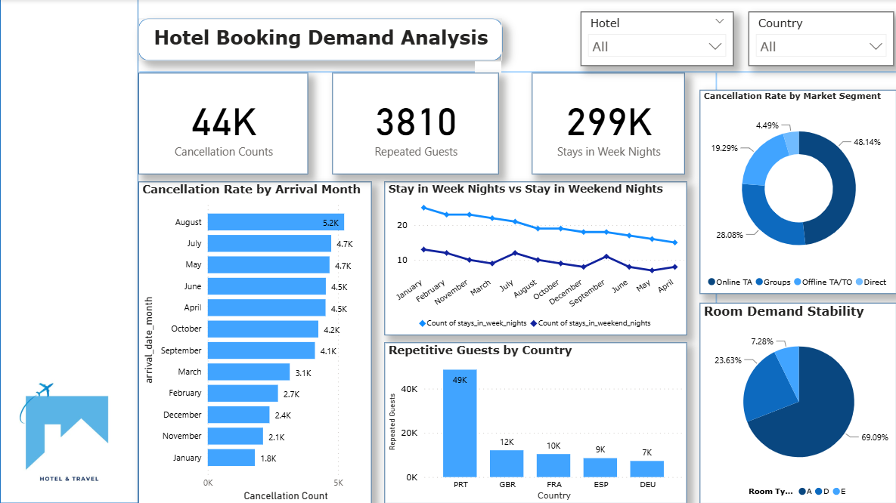

# Hotel Booking Demand Analytics — Power BI


An interactive Power BI dashboard that analyses **119K+ hotel bookings** to explain cancellations, seasonality, guest origin and room demand — built as a simulated freelance engagement for a hotel's Revenue Management and Marketing teams.



---

## Table of Contents

1. [Business Problem](#business-problem)
2. [Objectives](#objectives)
3. [Dataset](#dataset)
4. [Dashboard](#dashboard)
5. [Key Findings](#key-findings)
6. [Recommendations](#recommendations)
7. [Repository Structure](#repository-structure)
8. [How to Open](#how-to-open)
9. [Author](#author)

---

## Business Problem

The hotel's management faced four connected issues:

| # | Issue | Impact |
|---|-------|--------|
| 1 | **High cancellation rate** | Revenue uncertainty and unreliable occupancy forecasts |
| 2 | **Unstable room demand** across months, seasons and weekday/weekend | Hard to plan inventory, staffing and pricing |
| 3 | **Little visibility into repeated guests** | Loyalty value and source markets unclear |
| 4 | **Spreadsheet-only reporting** | No way to explore the data interactively |

## Objectives

- **Cancellation analysis** — volume of cancellations, peak months, and contribution by market segment (Online TA, Groups, Offline TA/TO, Direct).
- **Demand & seasonality** — weekday vs weekend nights, monthly patterns, and room-type mix.
- **Customer insights** — repeated guests and booking volume by country.
- **Dashboard** — one interactive page with Hotel and Country slicers for self-service exploration.

## Dataset

| Item | Detail |
|------|--------|
| Source | *Hotel Booking Demand* — Antonio, Almeida & Nunes (2019), *Data in Brief*; public on Kaggle |
| Scope | Two hotels in Portugal (City Hotel and Resort Hotel) |
| Period | Arrivals from July 2015 to August 2017 |
| Size | 119,390 bookings × 32 columns |

Column definitions for the fields used in the dashboard are in [`docs/data-dictionary.md`](docs/data-dictionary.md).

## Dashboard

| Visual | What it shows |
|--------|---------------|
| KPI cards | Total cancellations · Repeated guests · Total week nights stayed |
| Cancellations by Arrival Month | Number of cancelled bookings per month |
| Week vs Weekend Nights | Nights stayed on weekdays vs weekends, by month |
| Guests by Country | Top 5 source countries |
| Cancellations by Market Segment | Share of cancellations per segment |
| Room Type Mix | Share of demand by assigned room type |
| Slicers | Hotel (City / Resort) and Country |

DAX measures used and recommended are documented in [`docs/dax-measures.md`](docs/dax-measures.md).

## Key Findings

| # | Finding | Evidence |
|---|---------|----------|
| 1 | **Cancellations are a major issue** | ~44K of 119K bookings were cancelled (≈37%). |
| 2 | **Cancellations peak in late spring and summer** | August has the most cancellations (≈5.2K), followed by July and May; January has the fewest (≈1.8K). |
| 3 | **Online Travel Agencies drive nearly half of cancellations** | Online TA ≈ 48% of cancellations among the four main segments, ahead of Groups (≈28%) and Offline TA/TO (≈19%). Direct bookings are only ≈4.5%. |
| 4 | **Repeated guests are rare** | Only 3,810 bookings (≈3%) come from repeated guests — a small loyalty base. |
| 5 | **Portugal is by far the largest source market** | ≈49K bookings, about four times the next market (UK, ≈12K), followed by France, Spain and Germany. |
| 6 | **Room Type A dominates demand** | Room Type A takes the large majority of demand; D is a distant second and the remaining types are small. |
| 7 | **Weekday nights carry the volume** | Week nights consistently exceed weekend nights in every month (≈299K week nights in total). |

## Recommendations

1. **Tighten cancellation controls on OTA bookings** — offer partially or non-refundable rates, require deposits in peak months, and work with OTA partners to reduce speculative bookings.
2. **Plan peak months around expected cancellations** — use seasonal pricing and data-driven overbooking for May–August, and reward early confirmation or prepayment.
3. **Grow direct bookings** — the Direct segment cancels least; a best-rate guarantee and direct-booking perks shift volume toward it.
4. **Build a loyalty programme** — with only ≈3% repeated guests, there is room to convert the large Portuguese and UK guest bases into returning customers.
5. **Manage room inventory around Type A** — protect Type A availability in peak periods and upsell guests into under-used room types.
6. **Lift weekend occupancy** — weekend and family packages and dynamic weekend pricing.
7. **Next step: predictive modelling** — a cancellation-probability model and demand forecast feeding pricing and overbooking decisions.

## Repository Structure

```
hotel-booking-analytics-with-power-bi/
├── dashboard/
│   └── hotel-booking-demand-analysis.pbix   # Power BI report
├── docs/
│   ├── data-dictionary.md                   # Columns used
│   └── dax-measures.md                      # DAX measures
├── images/
│   └── dashboard-overview.png               # Dashboard screenshot
└── README.md
```

## How to Open

1. Install **[Power BI Desktop](https://powerbi.microsoft.com/desktop/)** (free, Windows).
2. Download or clone this repository.
3. Open `dashboard/hotel-booking-demand-analysis.pbix`.
4. Use the **Hotel** and **Country** slicers to filter every visual.

## Tools

- Microsoft Power BI Desktop — data modelling, DAX, visualisation
- Power Query — data preparation

## Author

**Yunido Baheramsyah** — Data Analyst
GitHub: [@brmsyh](https://github.com/brmsyh)

> This is a portfolio project based on a public dataset; the client scenario is simulated.
